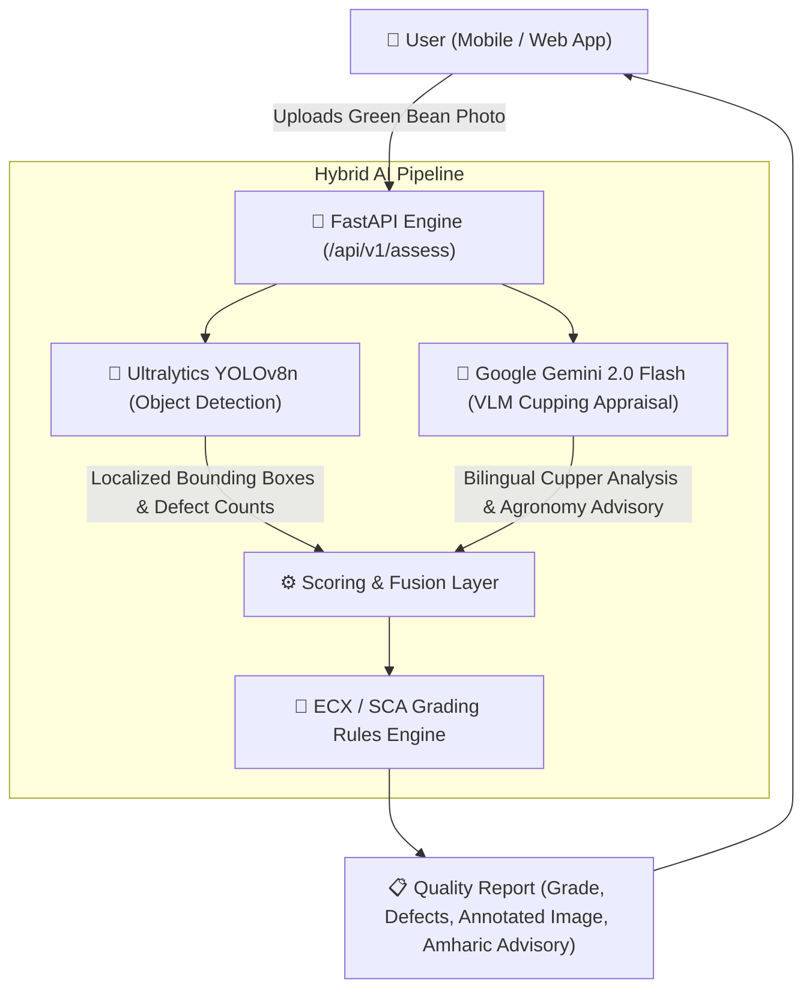

# ☕ BunaVision: AI-Powered Green Coffee Quality Pre-Assessment

[](https://fastapi.tiangolo.com)
[](https://docs.ultralytics.com)
[](https://ai.google.dev)
[](https://python.org)
[](https://docker.com)

> **BunaVision** is an AI-powered computer vision microservice designed to democratize green coffee quality pre-assessment for Ethiopian coffee producers, washing stations, and exporters. By combining **fine-tuned YOLOv8 object detection** with **Gemini 2.0 Flash multimodal reasoning**, BunaVision provides instant defect detection, bounding box localization, ECX/SCA grade estimation, and actionable bilingual agronomy advisories in **English and Amharic (አማርኛ)**.

---

## 📌 The Problem

In Ethiopia—the birthplace of Arabica coffee—formal grading relies entirely on manual physical inspection by certified Q-graders at centralized Ethiopian Commodity Exchange (ECX) laboratories.
* **Lack of Access:** Smallholder farmers and remote washing stations lack certified graders on site.
* **Uncertainty & Value Loss:** Producers frequently send lots to auction without knowing their preliminary grade, leading to downgrades, dispute delays, or loss of specialty premiums.
* **Inconsistency:** Fatigue and lighting variability cause inconsistent defect counting across manual visual checks.

## 💡 The Solution

BunaVision transforms a smartphone photo of green coffee beans spread on a clean surface into an instant, objective quality audit:
1. **Real-Time Localization:** Detects individual beans and classifies specific defects (Black, Broken, Insect Damaged, Sour).
2. **Defect Point Calculation:** Applies official ECX and Specialty Coffee Association (SCA) defect penalties.
3. **Bilingual Advisory:** Translates cupping findings into clear, actionable advice in Amharic so station managers can calibrate depulpers or adjust drying protocols before transport.

---

## 🏗️ System Architecture



---

## 📊 Ethiopian ECX & SCA Grading Rubric

BunaVision classifies samples into standard international and regional grade tiers:

| Grade | Classification | Primary Defects | Secondary Defects | Commercial Status |
| :--- | :--- | :---: | :---: | :--- |
| **Grade 1** | Specialty - Outstanding | 0 | $\le$ 3% | Premium Single-Origin Export |
| **Grade 2** | Specialty - Premium | 0 | $\le$ 8% | Specialty Export |
| **Grade 3** | Commercial Export | $\le$ 2 | $\le$ 15% | Standard Export Auction |
| **Grade 4** | Commercial Standard | $\le$ 4 | $\le$ 25% | Commercial Exchange |
| **Grade 5 / Local** | Undergrade | > 4 | > 25% | Domestic / Local Market Only |

* **Primary Defects (Severe):** Full Black, Full Sour/Stinker, Pod, Fungus/Mold, Severe Insect Damage (Broca).
* **Secondary Defects (Minor):** Partial Black, Partial Sour, Broken/Chipped, Immature/Quaker, Floater.

---

## 🚀 Quickstart Guide

### 1. Prerequisites
* Python 3.11+
* Gemini API Key ([Get free key from Google AI Studio](https://aistudio.google.com/))

### 2. Installation
```powershell
# Clone or navigate to directory
cd D:\Coding\Hackathon

# Activate virtual environment
.venv\Scripts\activate

# Install dependencies
pip install -r requirements.txt
```

### 3. Configure Environment
Create a `.env` file in the root directory:
```env
GEMINI_API_KEY=your_gemini_api_key_here
PORT=8000
HOST=0.0.0.0
```

### 4. Run the API Server
```powershell
uvicorn app.main:app --reload --host 0.0.0.0 --port 8000
```
* **Interactive API Documentation:** [http://localhost:8000/docs](http://localhost:8000/docs)
* **Health Check:** [http://localhost:8000/health](http://localhost:8000/health)

---

## 🛠️ API Endpoints

| Method | Endpoint | Description |
| :--- | :--- | :--- |
| `GET` | `/health` | Service health status, Gemini config, and YOLO model state |
| `POST` | `/api/v1/detect` | YOLOv8 bounding box defect detection and Base64 annotated image |
| `POST` | `/api/v1/assess` | Full hybrid assessment (YOLO boxes + Gemini cupping report + Amharic notes) |
| `POST` | `/api/v1/reload-model` | Hot-reloads `models/best.pt` dynamically without downtime |

---

## 📁 Project Structure

```text
D:\Coding\Hackathon\
├── app/
│   ├── config.py              # Environment configuration & .env loader
│   ├── main.py                # FastAPI routes, CORS, and middleware
│   ├── schemas.py             # Pydantic data schemas for ECX grading
│   └── services/
│       ├── gemini_vision.py   # Gemini 2.0 Flash multimodal Q-grader service
│       ├── grading_rules.py   # ECX / SCA defect point calculation engine
│       └── yolo_detector.py   # YOLOv8 bounding box detector & visual annotator
├── models/
│   ├── README.md              # Model weights guide
│   └── best.pt                # Fine-tuned YOLOv8n weights
├── train_yolov8_coffee.ipynb  # GPU training notebook (Google Colab)
├── API_INTEGRATION_GUIDE.md   # Integration handbook for frontend & backend devs
├── Dockerfile                 # Production deployment container
├── test_client.py             # CLI test runner
├── generate_test_image.py     # Synthetic test image generator
├── requirements.txt           # Pinned dependencies
└── README.md                  # Project documentation
```

---

## 🤝 Developer Handoff
For full code samples in **React, Flutter, and Django**, refer to [`API_INTEGRATION_GUIDE.md`](API_INTEGRATION_GUIDE.md).
