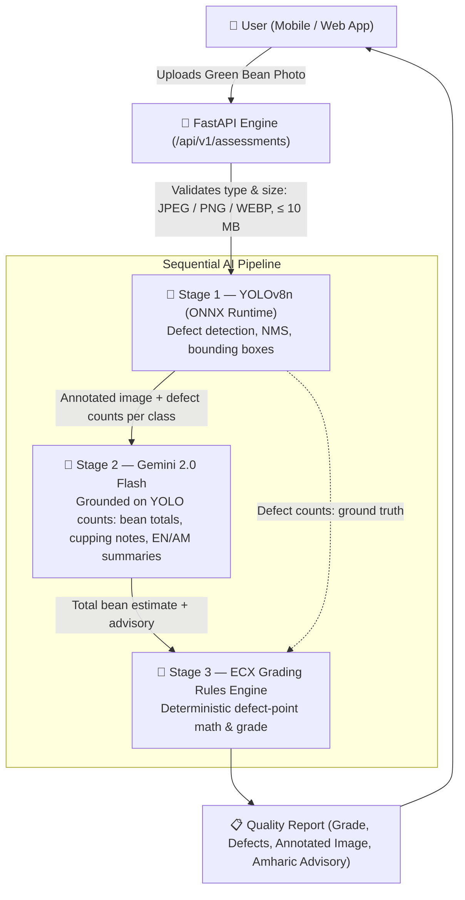

# ☕ BunaVision: AI-Powered Green Coffee Quality Pre-Assessment

[](https://fastapi.tiangolo.com)
[](https://docs.ultralytics.com)
[](https://ai.google.dev)
[](https://python.org)
[](https://docker.com)

> **BunaVision** is an AI-powered computer vision microservice designed to democratize green coffee quality pre-assessment for Ethiopian coffee producers, washing stations, and exporters. By combining **fine-tuned YOLOv8 object detection** with **Gemini 2.0 Flash multimodal reasoning**, BunaVision provides instant defect detection, bounding box localization, ECX/SCA grade estimation, and actionable bilingual agronomy advisories in **English and Amharic (አማርኛ)**.

---

## 📌 The Problem

In Ethiopia—the birthplace of Arabica coffee—formal grading relies entirely on manual physical inspection by certified Q-graders at centralized Ethiopian Commodity Exchange (ECX) laboratories.
* **Lack of Access:** Smallholder farmers and remote washing stations lack certified graders on site.
* **Uncertainty & Value Loss:** Producers frequently send lots to auction without knowing their preliminary grade, leading to downgrades, dispute delays, or loss of specialty premiums.
* **Inconsistency:** Fatigue and lighting variability cause inconsistent defect counting across manual visual checks.

## 💡 The Solution

BunaVision transforms a smartphone photo of green coffee beans spread on a clean surface into an instant, objective quality audit:
1. **Real-Time Localization:** Detects individual defective beans and classifies them. The current model covers 3 defect classes: Full Black, Partial Black, and Coffee Husk / Parchment.
2. **Defect Point Calculation:** Applies ECX defect-point equivalency rules to the detected counts to estimate a grade.
3. **Bilingual Advisory:** Translates cupping findings into clear, actionable advice in Amharic so station managers can calibrate depulpers or adjust drying protocols before transport.

---

## 🏗️ System Architecture

The pipeline is **sequential**, not parallel. The uploaded image goes to YOLO first; Gemini never sees the raw upload on its own — it receives YOLO's annotated image and verified defect counts.



| Stage | Module | Responsibility |
| :--- | :--- | :--- |
| 1. Detection | `app/services/yolo_detector.py` | Runs the defect model, applies NMS, draws colour-coded boxes (red = primary, amber = secondary) and returns per-class defect counts. |
| 2. Multimodal analysis | `app/services/gemini_vision.py` | Sends the YOLO-annotated image plus verified counts to Gemini, which estimates total/healthy beans, writes cupping notes and bilingual summaries. |
| 3. Grading | `app/services/grading_rules.py` | Converts YOLO's defect counts into ECX defect points and assigns the grade. Gemini never decides the grade. |

> **Note:** YOLO only counts defects, so the total bean count comes from Gemini's visual estimate. YOLO defect counts are always the source of truth for defects; the grade is computed deterministically from them and is never taken from Gemini.

---

## 📊 Ethiopian ECX & SCA Grading Rubric

BunaVision classifies samples into standard international and regional grade tiers:

Grades are computed from **defect points** (not percentages), as implemented in `app/services/grading_rules.py`:

| Grade | Classification | Primary Points | Secondary Points | Commercial Status |
| :--- | :--- | :---: | :---: | :--- |
| **Grade 1** | Specialty - Outstanding | 0 | < 3 | Premium Single-Origin Export |
| **Grade 2** | Specialty - Premium | 0 | $\le$ 6 | Specialty Export |
| **Grade 3** | Commercial Specialty | $\le$ 2 | $\le$ 12 | Standard Export Auction |
| **Grade 4** | Commercial | $\le$ 4 | $\le$ 25 | Commercial Exchange |
| **Grade 5** | Commercial (low) | $\le$ 8 | any | Bulk commodity blending |
| **Ungraded** | Local Market Only | > 8 | any | Domestic / Local Market Only |

* **Primary Defects (Severe):** Full Black, Full Sour/Stinker, Pod, Fungus/Mold, Severe Insect Damage, Foreign Matter (1 item = 1 point).
* **Secondary Defects (Minor):** Partial Black (3 = 1 point), Partial Sour (3 = 1), Parchment/Husk, Floater, Immature, Broken/Chipped (5 = 1), Slight Insect Damage (10 = 1).
* **Model coverage:** The current YOLO model detects only Full Black, Partial Black, and Coffee Husk / Parchment, so every grade is a *preliminary* estimate.

---

## 🚀 Quickstart Guide

### 1. Prerequisites
* Python 3.11+
* Gemini API Key ([Get free key from Google AI Studio](https://aistudio.google.com/))

### 2. Installation
```powershell
# Clone or navigate to directory
cd D:\Coding\Hackathon

# Activate virtual environment
.venv\Scripts\activate

# Install dependencies
pip install -r requirements.txt
```

### 3. Configure Environment
Create a `.env` file in the root directory:
```env
GEMINI_API_KEY=your_gemini_api_key_here
PORT=8000
HOST=0.0.0.0
```

### 4. Run the API Server
```powershell
uvicorn app.main:app --reload --host 0.0.0.0 --port 8000
```
* **Interactive API Documentation:** [http://localhost:8000/docs](http://localhost:8000/docs)
* **Health Check:** [http://localhost:8000/health](http://localhost:8000/health)

---

## 🛠️ API Endpoints

| Method | Endpoint | Description |
| :--- | :--- | :--- |
| `GET` | `/health` | Service health status, Gemini config, and YOLO model state |
| `POST` | `/api/v1/detect` | YOLOv8 bounding box defect detection and Base64 annotated image |
| `POST` | `/api/v1/assessments` | Full pipeline: YOLO detection → Gemini analysis → ECX grading (boxes, grade, cupping notes, Amharic summary) |
| `POST` | `/api/v1/reload-model` | Hot-reloads model weights (`models/best.onnx` preferred, `best.pt` fallback) without downtime |

---

## 📁 Project Structure

```text
D:\Coding\Hackathon\
├── app/
│   ├── config.py              # Environment configuration & .env loader
│   ├── main.py                # FastAPI routes, CORS, and middleware
│   ├── schemas.py             # Pydantic data schemas for ECX grading
│   └── services/
│       ├── yolo_detector.py   # Stage 1: YOLOv8 (ONNX) detector, NMS & visual annotator
│       ├── gemini_vision.py   # Stage 2: Gemini 2.0 Flash analysis; orchestrates the final report
│       └── grading_rules.py   # Stage 3: ECX defect point calculation & grade engine
├── models/
│   ├── README.md              # Model weights guide
│   ├── best.onnx              # Production ONNX model (90.5% mAP50)
│   ├── best.pt                # Fine-tuned YOLOv8n weights
│   └── classes.json           # Defect class mapping manifest
├── notebooks/
│   └── train_yolov8_coffee.ipynb  # GPU training pipeline (Google Colab)
├── tests/                     # Automated test suite (13/13 passing)
├── API_INTEGRATION_GUIDE.md   # Integration handbook for frontend & backend devs
├── Dockerfile                 # Production deployment container
├── pytest.ini                 # Test suite configuration
├── requirements.txt           # Pinned dependencies
└── README.md                  # Project documentation
```

---

## 🤝 Developer Handoff
For full code samples in **React, Flutter, and Django**, refer to [`API_INTEGRATION_GUIDE.md`](API_INTEGRATION_GUIDE.md).
